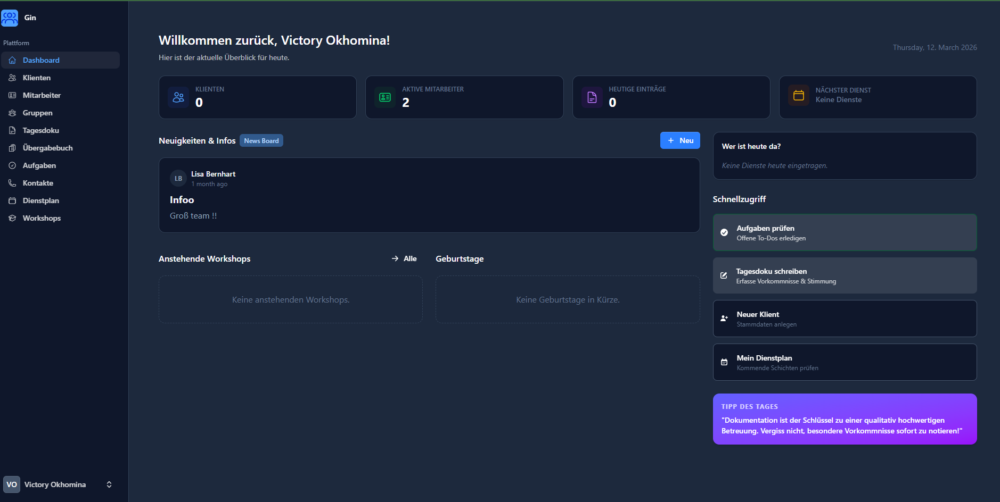
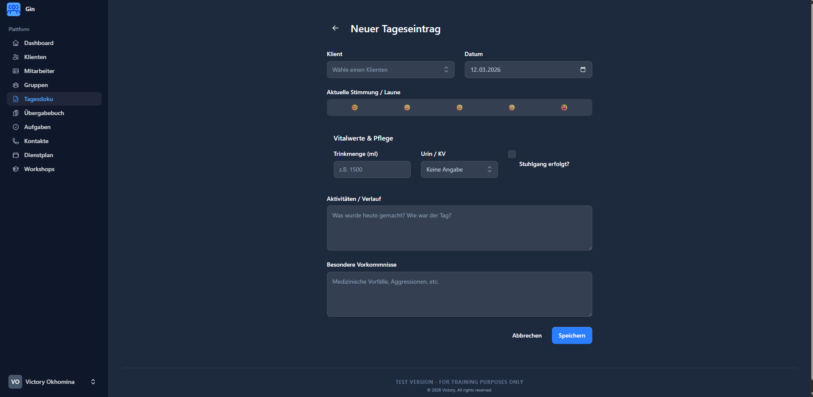
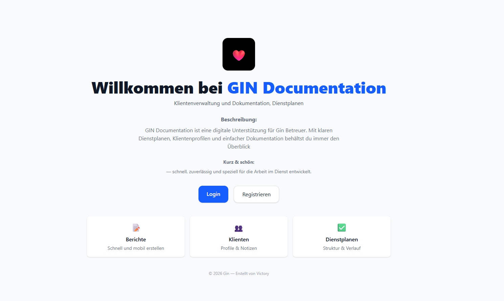
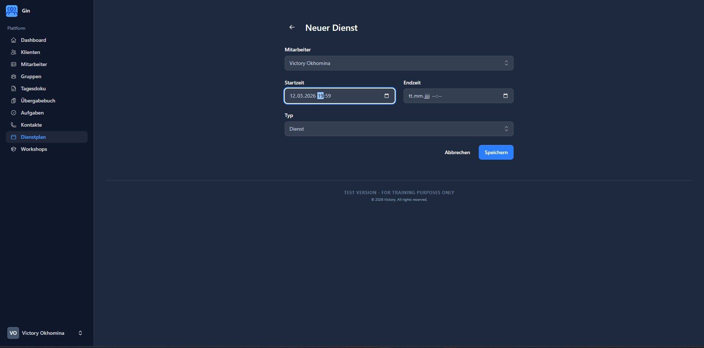

# Workshop & Shift Management System

A modern, full-featured workshop and shift management platform built with **Laravel 12**, **Livewire 3**, and **Flux**. Streamline operations with real-time updates, task tracking, and comprehensive shift management.

⚠️ **Work in Progress** — This project is under active development. Some features are still being implemented.

---

## 📋 Table of Contents

- [Features](#features)
- [Screenshots](#screenshots)
- [Tech Stack](#tech-stack)
- [Requirements](#requirements)
- [Installation](#installation)
- [Getting Started](#getting-started)
- [Project Structure](#project-structure)
- [Configuration](#configuration)
- [Security Features](#security-features)
- [Testing](#testing)
- [Contributing](#contributing)
- [License](#license)

---

## ✨ Features

- **Multi-user Workshop Management** — Create and manage workshops with participant tracking
- **Shift Management** — Assign and track shifts with detailed logging
- **Daily Logging** — Record daily operations and handover notes between shifts
- **Team Organization** — Organize users into groups with role-based access control
- **Real-time Updates** — Live data synchronization with Livewire reactive components
- **Task Management** — Assign and track tasks across teams and workshops
- **Client Management** — Track client information and contacts
- **Announcements** — Broadcast important updates to all users
- **Audit Trail** — Two-factor authentication and secure user management
- **Responsive Design** — Modern, mobile-friendly interface with Tailwind CSS and Flux

---

## � Screenshots

### Login & Landing Page

*Professional landing page with login and registration options*

### Dashboard

*Main dashboard showing overview, active employees, and quick actions*

### Create Shift

*Form to create new shifts with start/end times and employee assignment*

### Daily Log Entry

*Comprehensive daily logging with vital statistics, activities, and special notes*

---

## �🛠 Tech Stack

### Backend
- **PHP 8.2+** — Modern PHP with type hints and latest features
- **Laravel 12** — Full-featured web framework with built-in authentication
- **Livewire 3** — Reactive components without writing JavaScript
- **Flux 2** — Beautiful component library for Livewire
- **Volt** — Lightweight single-file components for rapid development

### Database
- **MySQL/Postgres** — Relational database with full migration system
- **Eloquent ORM** — Active record pattern with relationships

### Frontend
- **Livewire Flux** — Pre-built responsive components
- **Tailwind CSS 4.0** — Utility-first CSS framework
- **Vite** — Lightning-fast build tool and dev server
- **Alpine.js** — Reactive JavaScript (built into Livewire)

### Security & Authentication
- **Laravel Fortify** — Robust authentication scaffolding
- **Two-Factor Authentication (2FA)** — Enhanced security for user accounts
- **Blade Templating** — Secure template engine with automatic escaping

### Development & Testing
- **Pest** — Modern PHP testing framework
- **Laravel Sail** — Docker environment for development
- **Laravel Pint** — Code style fixer
- **Faker** — Generate realistic test data

---

## 📋 Requirements

- **PHP 8.2 or higher**
- **Composer** (dependency manager for PHP)
- **Node.js 18+** (for frontend dependencies)
- **npm or yarn** (for package management)
- **MySQL 8.0+** or **PostgreSQL 13+**
- **Git**

---

## 🚀 Installation

### 1. Clone the Repository

```bash
git clone <repository-url>
cd ginprojectv1
```

### 2. Install Dependencies

```bash
# PHP dependencies
composer install

# Frontend dependencies
npm install
```

### 3. Environment Setup

```bash
# Copy environment file
cp .env.example .env

# Generate application key
php artisan key:generate

# Configure your database in .env file
```

Edit the `.env` file and update:
```env
DB_CONNECTION=mysql
DB_HOST=127.0.0.1
DB_PORT=3306
DB_DATABASE=workshop_db
DB_USERNAME=root
DB_PASSWORD=
```

### 4. Database Migration & Seeding

```bash
# Run migrations
php artisan migrate

# (Optional) Seed with sample data
php artisan db:seed
```

### 5. Build Frontend Assets

```bash
# Development
npm run dev

# Production
npm run build
```

### 6. Start the Development Server

```bash
# Using PHP's built-in server
php artisan serve

# Or using Sail (Docker)
./vendor/bin/sail up
```

Access the application at `http://localhost:8000`

---

## 🎯 Getting Started

### First-time Setup

1. **Create User Account** — Register via the application
2. **Enable Two-Factor Authentication (Optional)** — For enhanced security
3. **Create a Group** — Organize team members
4. **Add Users** — Invite team members and assign roles
5. **Create Workshops** — Define workshop details and add participants
6. **Schedule Shifts** — Create shifts and assign team members
7. **Track Daily Logs** — Record daily activities and handover notes

### Key Sections

| Section | Purpose |
|---------|---------|
| **Workshops** | Create and manage workshops with participant lists |
| **Shifts** | Schedule and monitor shifts with detailed information |
| **Daily Logs** | Record daily operations and activities |
| **Tasks** | Assign and track action items |
| **Groups** | Organize users into teams with role-based access |
| **Clients** | Maintain client contact information |
| **Announcements** | Broadcast updates to all users |

---

## 📁 Project Structure

```
app/
├── Models/               # Eloquent models (Workshop, User, Shift, etc.)
├── Http/Controllers/     # API and web controllers
├── Livewire/            # Livewire components (real-time features)
├── Actions/             # Business logic classes
└── Providers/           # Service providers

database/
├── migrations/          # Database schema changes
├── factories/           # Model factories for testing
└── seeders/            # Database seeding

resources/
├── views/              # Blade templates
├── css/                # Stylesheet sources
├── js/                 # JavaScript assets
└── lang/               # Language files (en, de)

routes/
├── web.php             # Web routes
└── console.php         # Console commands

tests/
├── Feature/            # Feature tests
└── Unit/              # Unit tests

config/                 # Configuration files
```

---

## ⚙️ Configuration

### Environment Variables

**App Settings:**
```env
APP_NAME="Workshop Management"
APP_ENV=local
APP_DEBUG=true
APP_URL=http://localhost:8000
```

**Database:**
```env
DB_CONNECTION=mysql
DB_HOST=127.0.0.1
DB_DATABASE=workshop_db
```

**Mail (Optional):**
```env
MAIL_DRIVER=smtp
MAIL_HOST=smtp.mailtrap.io
MAIL_PORT=2525
```

**Fortify Configuration** (`config/fortify.php`):
- Email verification
- Two-factor authentication
- Password confirmation

---

## 🔒 Security Features

### Authentication & Authorization
- ✅ **User Authentication** — Secure login with email and password
- ✅ **Two-Factor Authentication (2FA)** — Additional security layer via TOTP
- ✅ **Role-Based Access Control** — User roles (admin, manager, user)
- ✅ **Password Hashing** — bcrypt with modern iterations
- ✅ **Remember Token** — Secure session management

### Data Protection
- ✅ **CSRF Protection** — Token-based form validation
- ✅ **SQL Injection Prevention** — Parameterized queries via Eloquent ORM
- ✅ **XSS Protection** — Automatic HTML escaping in Blade templates
- ✅ **Rate Limiting** — Throttle API requests to prevent abuse
- ✅ **Secure Headers** — HTTP security headers for modern browsers

### Best Practices
- ✅ **Environment Secrets** — Sensitive data in .env files (excluded from git)
- ✅ **Password Validation** — Strong password requirements
- ✅ **Session Security** — Secure, HttpOnly cookies
- ✅ **User Notification** — Login alerts and security notifications
- ✅ **Audit Logging** — Track important user actions

### Deployment Security
- Set `APP_DEBUG=false` in production
- Keep dependencies updated: `composer update && npm update`
- Use HTTPS/SSL certificates
- Configure proper database backups
- Implement rate limiting on production

---

## 🧪 Testing

Run tests with Pest:

```bash
# Run all tests
php artisan test

# Run specific test file
php artisan test tests/Feature/WorkshopTest.php

# Run with coverage
php artisan test --coverage

# Run unit tests only
php artisan test tests/Unit/
```

### Example Test Structure
```php
test('user can create workshop', function () {
    $user = User::factory()->create();
    $this->actingAs($user);
    
    $response = $this->post('/workshops', [
        'name' => 'Q1 Training',
        'date' => now(),
    ]);
    
    $response->assertRedirect();
    $this->assertDatabaseHas('workshops', ['name' => 'Q1 Training']);
});
```

---

## 📦 Maintenance

### Update Dependencies

```bash
# PHP dependencies
composer update

# Frontend dependencies
npm update

# Check for security vulnerabilities
composer audit
npm audit
```

### Database Backups

```bash
# Create backup
php artisan backup:run

# List backups
php artisan backup:list
```

---

## 🤝 Contributing

1. Create a feature branch: `git checkout -b feature/your-feature`
2. Commit changes: `git commit -am 'Add new feature'`
3. Push to branch: `git push origin feature/your-feature`
4. Submit a Pull Request

**Code Standards:**
- Follow PSR-12 (PHP Coding Standards)
- Use Laravel conventions
- Write tests for new features
- Update documentation

---

## 📝 License

This project is licensed under the **MIT License** — see the LICENSE file for details.

---

## 📞 Support

For issues, questions, or feedback:
- Check existing issues and documentation
- Create an issue in the repository
- Contact the development team

---

## 🎯 Roadmap

- [ ] Mobile app (React Native)
- [ ] Advanced analytics dashboard
- [ ] Automated reporting
- [ ] SMS/Email notifications
- [ ] Export to PDF/Excel
- [ ] Multi-language support improvements
- [ ] Performance optimizations

---

**Built with ❤️ by the development team**
